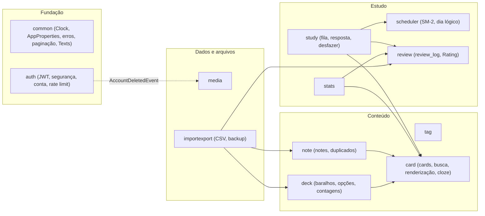

# Arquitetura e contrato da remodelagem (estilo Anki)

Documento de referência do que está **implementado**: modelo de domínio, esquema do banco, agendador SM-2, fila de
estudo, segurança, formatos de importação/exportação e as decisões que se afastaram do contrato inicial (seção 10).

Documentos relacionados: [`fluxos-de-negocio.md`](fluxos-de-negocio.md) (regras e fluxos com diagramas),
[`api.md`](api.md) (referência dos endpoints) e o [`README`](../README.md) (como rodar e configurar).

## 1. Stack e convenções

- Java 21, Spring Boot 3.5 (Web, Data JPA, Security, Validation), Flyway, PostgreSQL (H2 nos testes de API),
  JWT (jjwt 0.12), springdoc-openapi (Swagger UI), Apache Commons CSV, Lombok.
- Pacote raiz `com.example.flashcards_api`, organizado **por funcionalidade**. Cada módulo tem entidade(s),
  repositório, serviço (`@Transactional`), controller e DTOs (`record`).
- **Escopo por usuário**: toda entidade de domínio tem `userId` (coluna `user_id`, FK `ON DELETE CASCADE`); todo
  acesso é filtrado por `userId` (`findByIdAndUserId`). Recurso de outro usuário responde **404**.
- **Datas e horas**: `java.time.Instant` / `timestamptz` (UTC). Nunca `LocalDateTime`. O tempo vem sempre de um
  `java.time.Clock` injetado (bean em `common.AppConfig`), nunca de `Instant.now()` direto; os testes trocam o relógio
  (`MutableClock`). A auditoria JPA (`created_at`/`updated_at`) também usa esse `Clock`.
- **Erros**: `application/problem+json` (RFC 7807, `ProblemDetail`) com lista `errors` nos erros de campo.
  `common.GlobalExceptionHandler` mapeia `NotFoundException` (404), `ConflictException` (409), `BusinessRuleException`
  (422), validação de bean/parâmetro (422), corpo malformado e tipo de parâmetro (400), violação de integridade e
  *optimistic locking* (409) e o resto vira 500 genérico (sem vazar SQL). `DuplicateNoteException` (409) acrescenta
  `existingNoteId` (`note.NoteExceptionHandler`). Erros 401/403 gerados na cadeia de filtros usam
  `auth.ProblemResponseWriter`.
- **Paginação**: `page` (base 0), `size` (padrão 20, máx. 100) e `sort` por *whitelist*, via `common.PageRequests`;
  resposta `PageResponse<T>` (`items`, `page`, `size`, `totalElements`, `totalPages`). Só `POST /cards/search` é paginado.
- **Documentação**: Javadoc em português em toda classe pública e método público de serviço/controller; comentários só
  onde o "porquê" não é óbvio.
- Prefixo da API: `/api/v1` (o contrato mudou de forma incompatível com a versão anterior; ver seção 10).

## 2. Estrutura de pacotes



| Pacote | Responsabilidade |
|---|---|
| `common` | `AppConfig` (Clock UTC, auditoria JPA), `AppProperties` (`app.study.*`, `app.media.*`), `GlobalExceptionHandler`, exceções de domínio, `PageRequests`/`PageResponse`, `Texts` (normalização, `dup_key`, tags), `Auditable` |
| `auth` | cadastro/login/troca de senha/exclusão de conta, `JwtService` + `JwtSecretValidator`, `JwtAuthenticationFilter`, `SecurityConfig` (CORS, rotas públicas), `LoginRateLimiter`, `OpenApiConfig`, `AccountDeletedEvent` |
| `deck` | `Deck`, `DeckOptions`, árvore com contagens (`DeckCountsProvider` / `DefaultDeckCountsProvider`), `UserDefaultsService` (opções e baralho `Padrão`) |
| `tag` | CRUD de tags (renomear/mesclar/excluir) |
| `note` | `Note`, criação com geração de cards, edição (regeneração de cloze), duplicados, `NoteTagResolver` |
| `card` | `Card`, `CardState`, busca (`CardSpecifications`), ações em lote, `Cloze` e `CardRenderer` (**fonte única** de pergunta/resposta, usada por busca e estudo) |
| `scheduler` | `Sm2Scheduler` (puro, sem I/O), `DayBoundary`, `CardSnapshot`, `SchedulingResult`, `Preview` |
| `review` | `ReviewLog`, `Rating` (1..4), `ReviewLogRepository` |
| `study` | `StudyQueueService` (fila), `StudyService` (resposta, leech, enterrar irmãos, desfazer), `CardContentRenderer` (adaptador para `CardRenderer`) |
| `stats` | `StatsService` e consultas agregadas; `StudyDay` (dia lógico) |
| `media` | upload/download/exclusão, `MediaTypeDetector` (magic bytes), `MediaAccountCleanup` (ouvinte do evento), limites multipart |
| `importexport` | importação CSV, exportação CSV, backup/restauração JSON |

Pontos de extensão e desacoplamento:

- `DeckCountsProvider` (em `deck`): interface que calcula as contagens da árvore de baralhos; a implementação padrão é
  `DefaultDeckCountsProvider` (duas consultas agrupadas, independente do número de baralhos). Outro módulo pode
  fornecer uma implementação `@Primary`.
- `AccountDeletedEvent` (em `auth`): publicado após excluir a conta; `media.MediaAccountCleanup` o ouve em
  `AFTER_COMMIT` para apagar os arquivos. Novos módulos com recursos fora do banco devem fazer o mesmo.
- `Sm2Scheduler` não conhece JPA (`CardSnapshot` → `SchedulingResult`), o que o torna testável sem banco.

## 3. Modelo de domínio

```
user ─1:N─ deck (parent_id, options_id) ─N:1─ deck_options
user ─1:N─ note (note_type, front, back, image_url) ─N:M─ tag
note ─1:N─ card (deck_id, ordinal, estado de agendamento)
card ──────< review_log (um registro por resposta; base de estatísticas e do "desfazer")
user ─1:N─ media (metadados; o arquivo fica no disco)
```

- **Note** guarda o conteúdo. **Card** é o que se estuda e guarda o estado de agendamento. Um note gera 1..N cards
  conforme o tipo.
- Tipos de nota (enum fixo `NoteType`; tipos customizados ficam como melhoria futura):

| Tipo | Campos usados | Cards gerados | Pergunta / Resposta |
|---|---|---|---|
| `BASIC` | front, back | 1 (ordinal 0) | front / back |
| `BASIC_REVERSED` | front, back | 2 (ordinal 0 e 1) | 0: front→back, 1: back→front |
| `CLOZE` | front (texto com `{{c1::resp}}`, `{{c2::resp::dica}}`), back (extra, opcional) | 1 por número de cloze distinto (ordinal = n−1) | pergunta oculta o cloze n (`[...]` ou `[dica]`); resposta revela (`<b>…</b>`) e acrescenta o extra |
| `TYPE_IN` | front, back | 1 | front / back; o cliente pede a digitação e compara |

- `image_url` é opcional em qualquer tipo. Um note precisa de `front` não vazio **ou** `image_url`. Mídia enviada em
  `/media` **não** é vinculada ao note: o cliente guarda a `url` retornada em `image_url`.
- Tags: texto livre, normalizado (`trim`, minúsculas, espaços viram `-`, máx. 100 caracteres), único por usuário. A tag
  pertence ao note. A tag `leech` é criada pelo sistema.
- Baralhos aninhados: `parent_id`; caminho completo `Pai::Filho` (por isso o nome não pode conter `::`); profundidade
  máxima 8; nome único entre irmãos (sem diferenciar maiúsculas). Um card pertence a **um** baralho.
- Opções de baralho (`deck_options`): conjunto nomeado reutilizável; todo baralho aponta para um. O agendador e os
  limites diários usam as opções do baralho **do próprio card**.
- Cloze: números 1..99; vários clozes com o mesmo número formam o mesmo card (`card.Cloze`).

## 4. Esquema do banco

Migrações Flyway em `src/main/resources/db/migration`: `V1__create_schema` e `V2__create_session` (modelo legado),
`V4__anki_remodel` e `V5__media`. A `V3` é um *seed* local de desenvolvimento, **fora do repositório**; nenhuma outra
migration depende dela (a V4 dá os padrões a qualquer usuário que ela crie). `spring.jpa.hibernate.ddl-auto = validate`:
mudança de esquema só por nova migration.

Convenções: `BIGSERIAL` como PK, `timestamptz`, `ON DELETE CASCADE` nas FKs de `user_id`.

**`"user"`**: `created_at`/`updated_at` convertidos para `timestamptz`; `email` normalizado (`lower(btrim(email))`).

**`deck_options`**: `id`, `user_id`, `name`, `is_default boolean`, `new_per_day int=20`, `reviews_per_day int=200`,
`learning_steps varchar(100)='1 10'` (minutos, separados por espaço), `relearning_steps varchar(100)='10'`,
`graduating_interval_days int=1`, `easy_interval_days int=4`, `starting_ease int=2500` (permil), `easy_bonus int=130`,
`hard_interval int=120`, `interval_modifier int=100`, `lapse_new_interval int=0` (% do intervalo mantido após lapso),
`minimum_interval int=1`, `maximum_interval int=36500`, `leech_threshold int=8`, `bury_siblings boolean=true`,
`created_at`, `updated_at`. Índice único `(user_id, lower(name))`.

**`deck`**: `id`, `user_id`, `parent_id` (FK `deck`, cascade), `name varchar(255)`, `options_id` (FK `deck_options`,
**restrict**), `created_at`, `updated_at`. Índice único `(user_id, COALESCE(parent_id,0), lower(name))`.

**`note`**: `id`, `user_id`, `note_type varchar(20)` (CHECK nos 4 valores), `front text`, `back text`,
`image_url varchar(2048)`, `guid varchar(36)` único (no banco inteiro), `dup_key varchar(64)` (**SHA-256 hex** do `front`
normalizado, `Texts.dupKey`: sem HTML, minúsculas, espaços colapsados; calculado em `@PrePersist/@PreUpdate`),
`created_at`, `updated_at`. CHECK `front <> '' OR image_url IS NOT NULL`. Índice `(user_id, note_type, dup_key)`.

**`tag`**: `id`, `user_id`, `name varchar(100)`; único `(user_id, name)`. **`note_tag`**: `(note_id, tag_id)` PK, ambas FKs
cascade, índice em `tag_id`.

**`card`**: `id`, `user_id`, `note_id` (cascade), `deck_id` (cascade), `ordinal int`,
`state varchar(12)` (`NEW|LEARNING|REVIEW|RELEARNING`, CHECK), `position bigint` (ordem de introdução dos novos),
`due_at timestamptz not null`, `interval_days int=0`, `ease_permille int=2500`, `reps int=0`, `lapses int=0`,
`learning_step int=0`, `last_review_at timestamptz null`, `suspended boolean=false`, `buried_until timestamptz null`,
`flag smallint=0` (CHECK 0..7), `version bigint` (`@Version`), `created_at`, `updated_at`. Único `(note_id, ordinal)`.
Índices `(user_id, deck_id, state, due_at)`, `(note_id)` e `(deck_id)`.

**`review_log`**: `id`, `user_id` (cascade), `card_id bigint` (**sem FK**: o histórico sobrevive à exclusão do card),
`deck_id bigint` (sem FK), `rating smallint` (CHECK 1..4), `state_before`, `state_after`, `interval_before`,
`interval_after`, `ease_before`, `ease_after`, `due_before`, `due_after`, `reps_before`, `lapses_before`, `lapses_after`,
`learning_step_before`, `last_review_before`, `time_ms int`, `reviewed_at timestamptz`. As colunas `*_before` permitem
desfazer. Índices `(user_id, reviewed_at)` e `(card_id)`.

**`media`** (V5): `id`, `user_id` (cascade), `stored_name varchar(80)` (`<uuid>.<ext>`), `original_name varchar(255)`
(sanitizado, só informativo), `content_type varchar(100)`, `size_bytes bigint`, `created_at timestamptz`; índice
`(user_id)`. O conteúdo fica em `app.media.dir/<userId>/<stored_name>`.

### Migração dos dados legados (V4)

Na ordem:

1. `deck_options` padrão (`is_default=true`, nome `Padrão`) e baralho `Padrão` para **todo** usuário.
2. Cada `flashcard_group` vira um `deck` (raiz) com as opções padrão do usuário. Grupos de nome repetido (ou igual a
   `Padrão`) ganham sufixo ` (n)`; nome vazio vira `Grupo`.
3. Cada `flashcard` vira 1 `note` `BASIC` (`front = coalesce(text_content,'')`, `back = answer`, `image_url`,
   `guid = gen_random_uuid()`, `dup_key` calculado em SQL; sem texto nem imagem, `front = "(sem conteúdo)"`) + 1 `card`
   ordinal 0 (`position = id` legado). Sem `last_shown_date` → `NEW`; com data → `REVIEW` com `interval_days`
   1 / 6 / 21 para `low` / `medium` / `high`, `ease = 2500`, `reps = attempts_correct + attempts_incorrect`,
   `last_review_at = last_shown_date`, `due_at = now()`.
4. Um card em vários grupos fica no baralho do grupo de **menor id**; os outros grupos viram tags
   `grupo-<nome normalizado>` do note. Card sem grupo vai para o baralho `Padrão`.
5. Remove `flashcard_group_assignment`, `flashcard_group`, `flashcard` e `study_session` (que só guardava contagens
   enviadas pelo cliente e não é migrável para `review_log`). Colunas temporárias `legacy_*` são removidas ao fim.

Validado em PostgreSQL real por `MigrationPostgresTest` (Testcontainers).

## 5. Agendador SM-2 (`scheduler`)

Classe pura e sem I/O: `Sm2Scheduler.schedule(card, rating, options, now, day) -> SchedulingResult` e
`preview(card, options, now, day) -> Map<Rating, Preview>` (o que cada botão mostraria). `Rating` = `AGAIN(1)`,
`HARD(2)`, `GOOD(3)`, `EASY(4)`. Intervalos em dias inteiros; `ease` em permil (2500 = 250%), piso **1300**;
`mod = interval_modifier/100`. Sem *fuzz* (determinístico, facilita teste). Toda resposta incrementa `reps` e define
`last_review_at`; todo intervalo é limitado a `[minimum_interval, maximum_interval]`.

**Dia lógico** (`DayBoundary`): começa em `day_start_hour` (4) no fuso `app.study.zone` (UTC). Cards em `REVIEW` vencem no
início do dia lógico de `hoje + intervalo` (`startOfDayPlus`); cards em `LEARNING`/`RELEARNING` vencem no instante exato
(`now + passo`). O cálculo é feito com datas locais, tratando horário de verão.

| Estado | AGAIN | HARD | GOOD | EASY |
|---|---|---|---|---|
| `NEW` | `LEARNING` passo 0, vence em `passo[0]` | `LEARNING` passo 0, vence em média de `passo[0]` e `passo[1]` (2+ passos) ou `passo[0]×1,5` (1 passo) | 2+ passos: `LEARNING` passo 1; 1 passo: gradua | gradua com `easy_interval_days` |
| `LEARNING` (passo i) | passo 0 | repete o passo i | passo i+1, ou gradua se era o último | gradua com `easy_interval_days` |
| `REVIEW` | lapso (abaixo) | `h = max(i+1, round(i·hard_interval/100·mod))`, ease −150 (mín. 1300) | `g = max(h+1, round(i·ease/1000·mod))` | `max(g+1, round(i·ease/1000·easy_bonus/100·mod))`, ease +150 |
| `RELEARNING` (passo i) | passo 0 | repete o passo i | passo i+1, ou volta a `REVIEW` | volta a `REVIEW` (intervalo e ease atuais) |

- **Graduar** = `state=REVIEW`, `interval = graduating_interval_days` (ou `easy_interval_days` no EASY), `ease =
  starting_ease`, `learning_step = 0`. Sem passos de aprendizado, `NEW`/`LEARNING` graduam em qualquer botão.
- **Lapso** (AGAIN em `REVIEW`): `lapses+1`, `ease = max(1300, ease−200)`,
  `interval = clamp(round(interval·lapse_new_interval/100))`; com passos de reaprendizado vai a `RELEARNING` passo 0
  vencendo em `relearning_steps[0]`; senão permanece `REVIEW` com o novo intervalo. Se `lapses ≥ leech_threshold`, o
  resultado traz `leech=true` e o `StudyService` suspende o card e adiciona a tag `leech` ao note.
- `h` e `g` usados nas comparações são os valores **antes** do limite `[min, max]`.
- `Preview` formata o rótulo de cada botão: `<1m`, `10m`, `1.5h` (duração em aprendizado), `1d`..`29d`, `1mo`.. (30 dias),
  `1y`.. (365 dias). A previsão usa exatamente o mesmo código de `schedule`.
- **Fora do escopo (melhorias)**: bônus por atraso, *fuzz*, FSRS.

## 6. Fila de estudo (`study`)

Dia lógico = `[início, início+24h)` conforme a seção 5. Para cada card usa-se a opção do **próprio baralho do card**. Um
card é elegível se `suspended=false` e (`buried_until` nulo ou `<= now`).

Ordem de entrega: (1) `LEARNING`/`RELEARNING` com `due_at <= now`, por `due_at` (sem limite diário); (2) `REVIEW` com
`due_at <` início do próximo dia lógico, por `due_at`, respeitando `reviews_per_day − revisões já feitas hoje no baralho`;
(3) `NEW` por `position`, respeitando `new_per_day − novos já introduzidos hoje no baralho` (introduzido hoje =
`review_log` com `state_before=NEW` no dia lógico; revisão feita = `state_before=REVIEW`). `deckId` opcional inclui
subbaralhos; `limit` (1..200, padrão 50) corta a lista final, mas **não** as `counts`.

- **Consultas**: o número de consultas depende do número de baralhos, nunca do de cards (coberto por teste de contagem
  de statements).
- **Resposta** (`POST /study/cards/{id}/answer`): valida versão opcional (409), suspenso/enterrado (422), agenda, grava
  o `review_log`, aplica ao card (`@Version`), trata leech e enterra irmãos.
- **Enterrar irmãos**: se `bury_siblings`, os outros cards do mesmo note — exceto suspensos e os em
  `LEARNING`/`RELEARNING` — ficam com `buried_until` = início do próximo dia lógico.
- **Concorrência**: `card.version` (`@Version`); `version` na requisição é opcional; conflito responde 409.
- **Desfazer** (`POST /study/undo`): reverte a última resposta **do usuário** (maior id em `review_log`): restaura o
  card pelas colunas `*_before`, apaga o log, desenterra os irmãos com `buried_until` = início do próximo dia lógico
  daquela resposta e desfaz suspensão/tag `leech` se foram causadas por ela. Repetível. Sem log → 404.

## 7. Segurança, erros e configuração

- **JWT** (HS256): `sub` = id do usuário, claim `email`, validade `jwt.expiration` (ms, padrão 24 h). O segredo
  `jwt.secret` (`JWT_SECRET`) é **obrigatório**, em Base64, com ao menos 32 bytes decodificados; ausente, inválido ou
  igual ao segredo público de exemplo antigo, a aplicação **não sobe** (`JwtSecretValidator`; só
  `jwt.allow-insecure-default=true` libera o valor público, para dev/testes). Gerar: `openssl rand -base64 48`.
- `JwtAuthenticationFilter` analisa o token uma única vez e confirma que o usuário **ainda existe** (uma consulta por
  requisição); o principal é o `Long` id do usuário (`@AuthenticationPrincipal Long userId`). Não há papéis. Token inválido
  deixa a requisição anônima (rotas públicas continuam acessíveis; rotas protegidas respondem 401 `problem+json`).
- `SecurityConfig`: stateless, CSRF desligado (API JSON com Bearer, sem cookies); públicos: `POST /auth/register`,
  `POST /auth/login` e, se `app.docs.public=true` (padrão), `/swagger-ui/**`, `/swagger-ui.html`, `/v3/api-docs/**`.
- **CORS**: `app.cors.allowed-origins` (lista separada por vírgulas; padrão `http://localhost:3000,http://localhost:5173`);
  métodos `GET, POST, PUT, PATCH, DELETE, OPTIONS`; cabeçalhos `Authorization, Content-Type, Accept`; expostos
  `Retry-After, Content-Disposition`; sem credenciais; `max-age` 3600 s.
- **Rate limit de login** (`LoginRateLimiter`): chave e-mail normalizado + IP (`remoteAddr`); janela fixa que começa na
  primeira falha; `app.login.max-failures` (10) em `app.login.window-minutes` (15) → 429 com `Retry-After`; sucesso zera.
  Em memória, **por instância** (com várias réplicas o limite efetivo multiplica; para um limite global use Redis ou o
  proxy reverso). Atrás de proxy, configure `server.forward-headers-strategy`.
- **Senhas**: BCrypt; no máximo 72 bytes UTF-8 (limite do algoritmo) — acima disso 422, para não truncar em silêncio.
- **Mídia**: tipo decidido por magic bytes (PNG, JPEG, GIF, WebP, MP3, OGG, WAV, M4A); nome gerado no servidor; o nome do
  cliente nunca é usado como caminho (e a resolução do caminho verifica que não saiu do diretório do usuário).
  Limites multipart alinhados a `app.media.max-bytes` (`MediaConfig`), valendo também para o CSV.
- **Configuração própria** (`@ConfigurationProperties("app")`, `AppProperties`): `app.study.zone` (`UTC`),
  `app.study.day-start-hour` (`4`), `app.media.dir` (`./data/media`), `app.media.max-bytes` (10 MB). Lidas com `@Value`:
  `app.cors.allowed-origins`, `app.docs.public`, `app.login.max-failures`, `app.login.window-minutes`. Lista completa
  e variáveis de ambiente no README.

## 8. Endpoints (`/api/v1`)

Resumo; a referência completa (corpos, respostas, erros) está em [`api.md`](api.md). Todos exigem JWT, exceto
`auth/register`, `auth/login` e a documentação (por padrão).

- **auth/conta**: `POST /auth/register`, `POST /auth/login`, `POST /auth/change-password`, `DELETE /account` (corpo com senha).
- **decks**: `GET /decks` (árvore com contagens `new/learning/review` de hoje), `POST /decks`, `GET /decks/{id}`,
  `PATCH /decks/{id}` (`name`, `parentId`, `optionsId`), `DELETE /decks/{id}` (remove subbaralhos e cards; notes sem cards são removidos).
- **deck-options**: `GET|POST /deck-options`, `GET|PUT|DELETE /deck-options/{id}`, `POST /deck-options/{id}/default`
  (não remove padrão nem em uso).
- **tags**: `GET /tags` (com contagem), `PATCH /tags/{id}` (renomear; se já existir, mescla), `DELETE /tags/{id}`.
- **notes**: `POST /notes`, `GET /notes/duplicates`, `GET /notes/{id}`, `PATCH /notes/{id}` (regera cards de cloze),
  `DELETE /notes/{id}`, `GET /notes/{id}/cards`.
- **cards**: `POST /cards/search` (texto, `deckId`+subbaralhos, tags, estados, suspenso, flag, vencimento, lapsos, tipo;
  paginado, ordenável), `GET /cards/{id}`, `PATCH /cards/{id}` (`suspended`, `flag`, `deckId`), `POST /cards/bulk`
  (`SUSPEND`, `UNSUSPEND`, `FLAG`, `MOVE`, `ADD_TAG`, `REMOVE_TAG`, `RESET`, `DELETE`; até 500 ids; atômico).
- **study**: `GET /study/queue?deckId=&limit=`, `POST /study/cards/{id}/answer` (`rating`, `timeMs`, `version`), `POST /study/undo`.
- **stats**: `GET /stats/today`, `/stats/overview?deckId=`, `/stats/forecast?days=30`, `/stats/heatmap?from=&to=`,
  `/stats/retention?days=30`, `/stats/streak` (todos com `deckId` opcional, exceto `today` e `streak`).
- **media**: `POST /media` (multipart `file`), `GET /media/{id}`, `DELETE /media/{id}`.
- **import/export**: `POST /import/csv`, `POST /import/backup`, `GET /export/csv?deckId=`, `GET /export/backup`.

### Formatos de importação e exportação

**CSV** (UTF-8, RFC 4180; BOM aceito). Exportação: cabeçalho `deck,noteType,front,back,tags,imageUrl`, uma linha por note
(o baralho é o do card de menor ordinal dentro do escopo), tags separadas por espaço, valores sem alteração (sem proteção
contra fórmulas de planilha, para o round-trip ser fiel). Importação: delimitador `,` `;` ou tab (auto-detectado),
cabeçalho opcional (colunas `front`, `back`, `tags`, `deck`, `noteType`, `imageUrl`; sem cabeçalho: `front,back,tags,deck`),
até 10 000 linhas, tudo-ou-nada (ou `skipInvalid`), duplicados ignorados e relatados.

**Backup JSON** (`BackupModel`, `version = 1`): objeto com `version` (primeira chave), `exportedAt` e as listas
`deckOptions`, `decks`, `notes` (com `guid` e `tags` por nome), `cards` (com todo o agendamento) e `reviewLogs`, nessa
ordem. Escrito e lido por *streaming* em blocos; restauração só em conta sem notes nem cards, em uma transação, com ids
remapeados e `guid` regenerado. **Não** inclui arquivos de mídia nem a conta (senha).

## 9. Melhorias futuras (fora do escopo desta entrega)

- Sincronização offline-first para clientes móveis (USN / `updated_at` por entidade, resolução de conflitos).
- FSRS como segundo algoritmo, selecionável por baralho; bônus de atraso e *fuzz* no SM-2.
- Tipos de nota customizados e templates HTML/CSS; importação/exportação `.apkg`.
- Refresh token e revogação, recuperação de senha e verificação de e-mail (exigem infraestrutura de e-mail); rate limit
  distribuído (hoje em memória).
- Baralhos compartilhados, modo multiusuário/organização, papéis (admin).
- Backup assíncrono (hoje síncrono, por *streaming*) e armazenamento de mídia em S3 (hoje disco local; o backup não leva a mídia).

## 10. Decisões e desvios do contrato

Resumo do que o código faz de forma diferente ou mais específica que o contrato inicial:

- **`dup_key` é um hash SHA-256** (64 hex) do `front` normalizado, não o texto normalizado; igual no código
  (`Texts.dupKey`) e na migration V4 (SQL).
- **Autenticação ampliada**: além de register/login, `POST /auth/change-password` (nova senha 8..72, enquanto o cadastro
  aceita 6..72), `DELETE /account` (cascata + limpeza de mídia via `AccountDeletedEvent`), rate limit de login (429),
  normalização de e-mail e limite de 72 bytes na senha.
- **`JWT_SECRET` obrigatório**: o segredo de exemplo que já foi versionado é rejeitado na inicialização.
- **CORS e docs configuráveis**: `app.cors.allowed-origins` e `app.docs.public` (padrão `true`; use `false` em produção).
- **Rating aceita número ou nome** (`1..4`, `AGAIN`…`EASY`, sem diferenciar maiúsculas) e é gravado como `smallint`.
- **Limite diário é por baralho, na árvore e na fila**: `DefaultDeckCountsProvider` limita apenas os cards do próprio
  baralho pelas opções dele e o pai soma os filhos, exatamente como `StudyQueueService`. Assim a contagem exibida num
  baralho pai coincide com o que a fila entrega. (Limite que vale para toda a subárvore, como no Anki, fica como
  melhoria futura.)
- **Desfazer é global do usuário** (última resposta de qualquer baralho) e desenterra irmãos pelo valor de
  `buried_until` (início do próximo dia lógico da resposta); irmãos enterrados no mesmo dia por **outra** resposta do
  mesmo note também seriam desenterrados.
- **Edição de cloze protege histórico**: removem-se apenas cards com `reps = 0`; cards já revisados são mantidos.
- **Exclusão de baralho** apaga cards (e notes órfãos) e preserva o `review_log`; o baralho `Padrão` só é protegido
  enquanto for o único raiz.
- **Ações em lote são atômicas**: um id inválido aborta tudo (404). `RESET` não remove suspensão/bandeira.
- **Mídia no disco local** (`app.media.dir/<userId>/`), sem vínculo estrutural com notes (apenas `image_url`); o backup
  JSON não inclui os arquivos.
- **Importação CSV**: valida tudo antes de gravar; hoje **não** exige `back` nos tipos não-cloze e reconhece números de cloze de até 3 dígitos (a API de notes exige
  `back` e limita o cloze a 1..99); baralhos do caminho `deck` são criados a partir da raiz com as
  opções padrão.
- **Restauração de backup**: opções existentes com o mesmo nome (ex. `Padrão`) são sobrescritas; o flag `is_default` do
  backup não é reaplicado.
- **Testes**: APIs testadas em H2 (`ddl-auto=create-drop`, Flyway desligado); migração e cascata de exclusão de conta
  testadas em PostgreSQL real com Testcontainers (ignorados sem Docker).

### Incompatibilidades com a versão anterior

Os endpoints `/flashcards`, `/groups`, `/sessions` e `/study/flashcards*` foram removidos. Equivalências:
flashcard → note + card, grupo → deck, `DominanceLevel` → estado SM-2, `StudySession` → `review_log`/`stats`. Tabela
completa de equivalência de endpoints em [`fluxos-de-negocio.md`](fluxos-de-negocio.md#8-migração-dos-dados-legados-v4).

## 11. Notas de implementação

- Auditoria (`created_at`/`updated_at`) via Spring Data (`@CreatedDate`/`@LastModifiedDate`, superclasse
  `common.Auditable`), alimentada pelo `Clock` da aplicação (`AppConfig`); entidades guardam `userId`, `deckId`, `noteId`,
  `parentId` e `optionsId` como `Long` simples (sem associações JPA), exceto `Note.tags` (`@ManyToMany`). `Media` e
  `ReviewLog` não herdam `Auditable` (têm `createdAt`/`reviewedAt` próprios).
- `DeckOptions.defaultOptions` mapeia a coluna `is_default`. `Rating` é gravado como `smallint` (1..4) por
  `RatingConverter` e serializado como número (`@JsonValue`).
- Novos usuários recebem opções e baralho `Padrão` em `UserDefaultsService.ensureDefaults(userId)` (chamado no registro, e
  de forma idempotente na listagem de opções, na criação de baralho e na importação CSV).
- Criação concorrente da mesma tag é tratada com `TagCreator` (transação `REQUIRES_NEW`) em `NoteTagResolver`.
- Consultas de busca/estatística evitam N+1 (notes com tags carregados em lote; agregações no banco) e há testes que
  contam *statements* (`DeckTreeQueryCountTest`, `CardApiTest`, `StudyApiTest`) e desempenho (`StatsPerformanceTest`).
