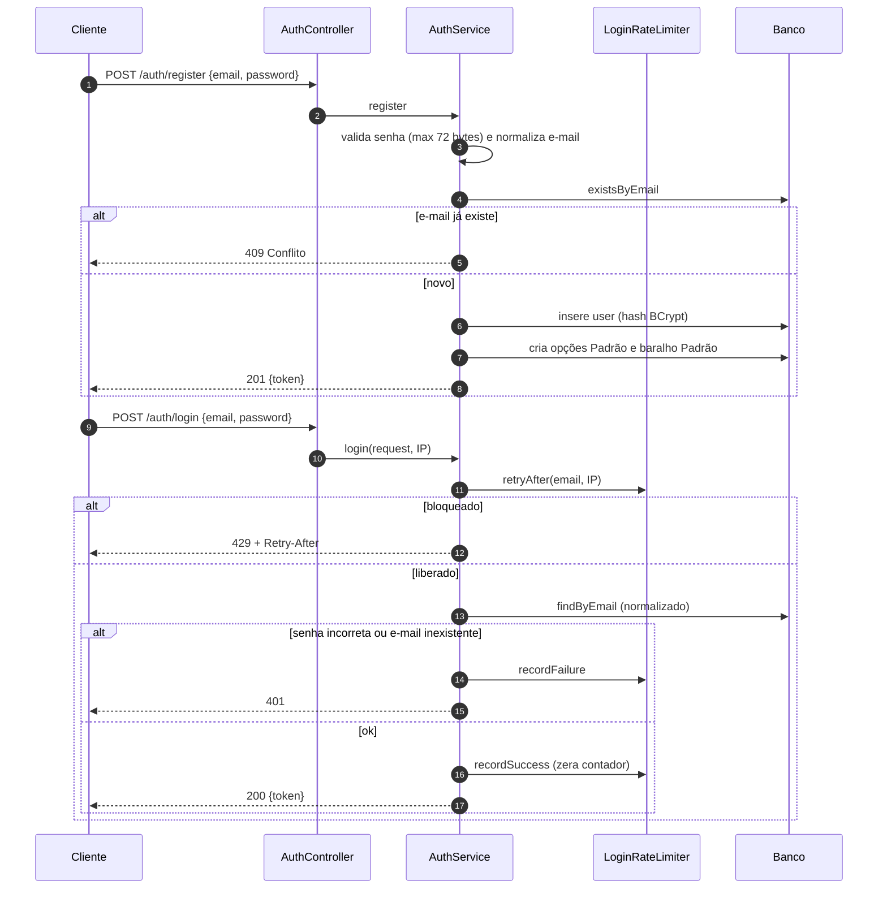
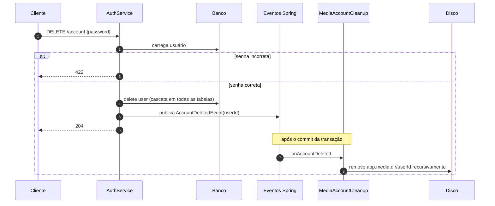
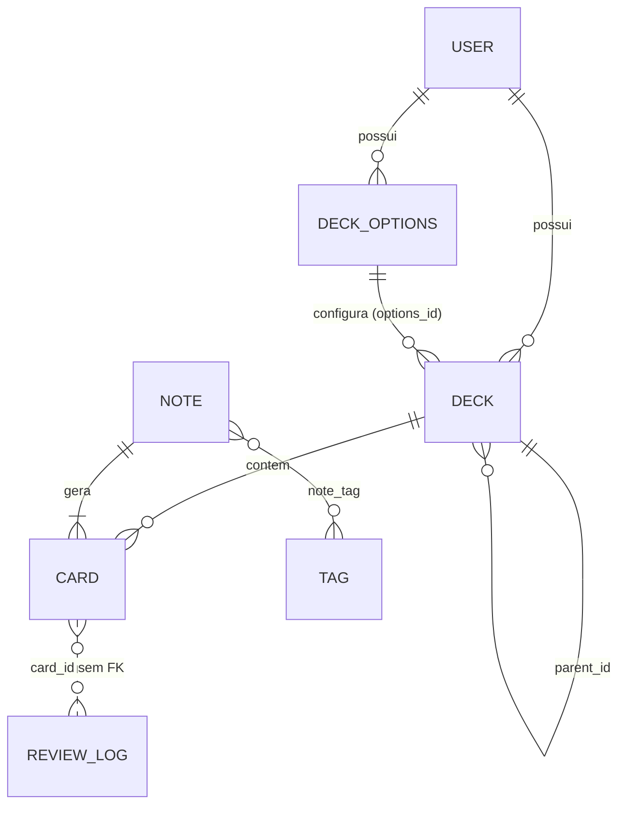
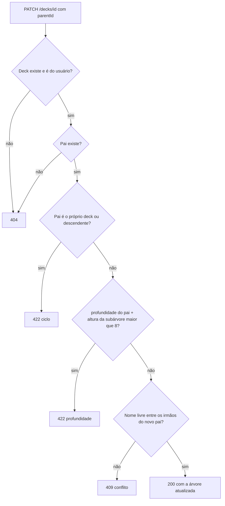
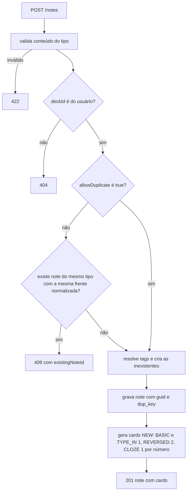
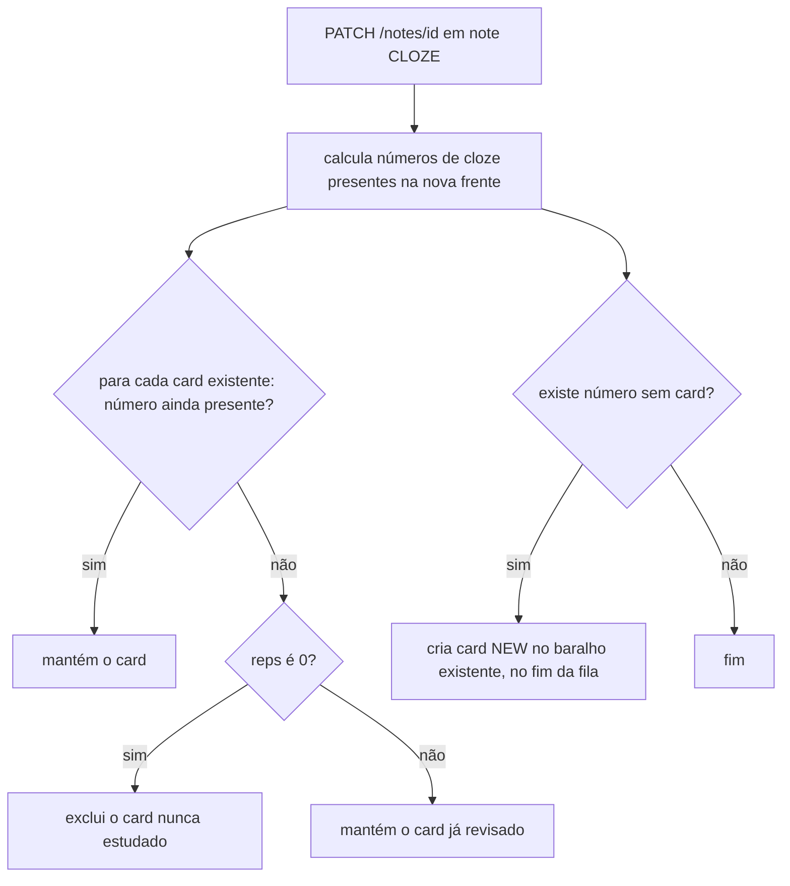
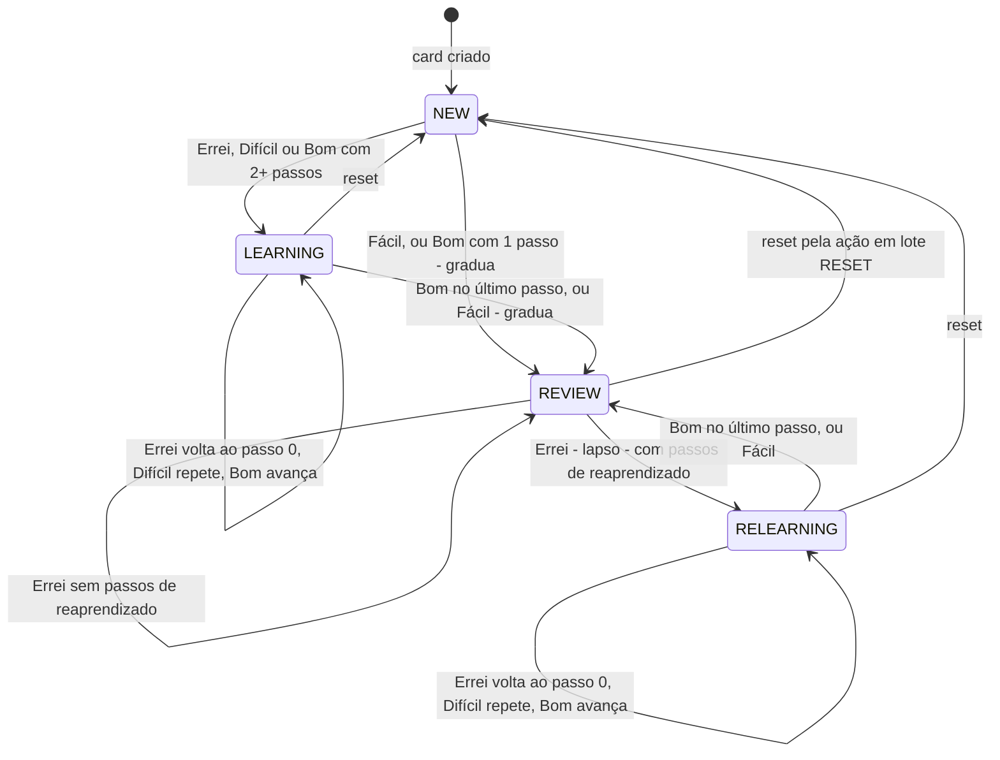
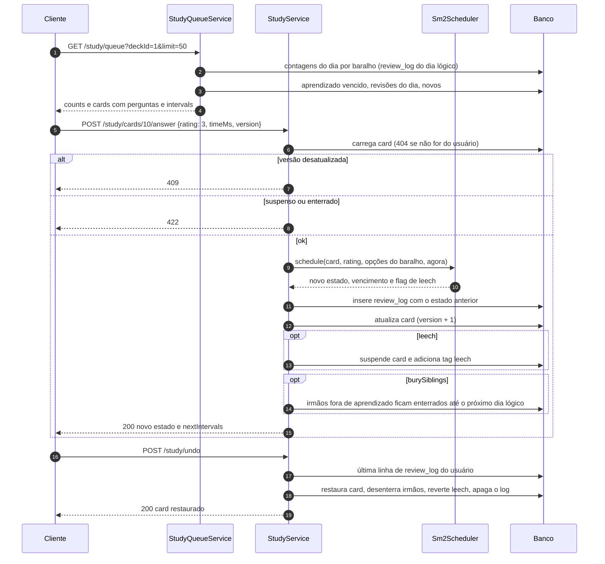
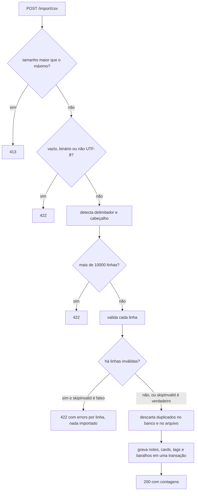
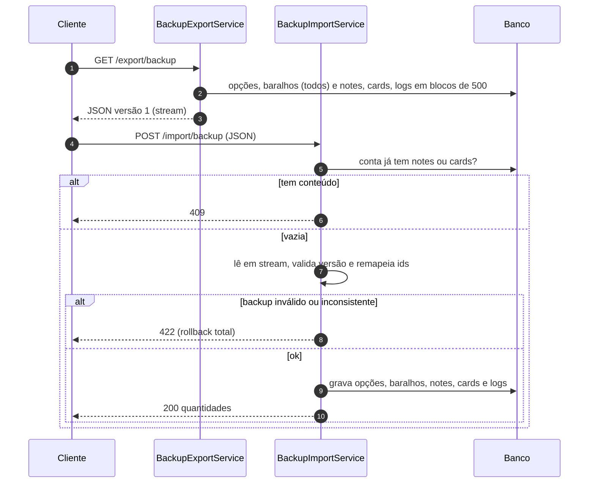

# Fluxos de negócio

Este documento descreve **como a API se comporta**, fluxo a fluxo: regras, invariantes, endpoints envolvidos e
erros. A fonte da verdade é o código (e os testes em `src/test`); a referência de cada endpoint está em
[`api.md`](api.md) e as decisões de arquitetura em [`arquitetura.md`](arquitetura.md).

Sumário

1. [Cadastro, login e conta](#1-cadastro-login-e-conta)
2. [Organização: baralhos, opções e tags](#2-organização-baralhos-opções-e-tags)
3. [Notes e geração de cards](#3-notes-e-geração-de-cards)
4. [Ciclo de vida do card](#4-ciclo-de-vida-do-card)
5. [Sessão de estudo ponta a ponta](#5-sessão-de-estudo-ponta-a-ponta)
6. [Estatísticas](#6-estatísticas)
7. [Mídia, importação CSV, exportação e backup](#7-mídia-importação-csv-exportação-e-backup)
8. [Migração dos dados legados (V4)](#8-migração-dos-dados-legados-v4)
9. [Glossário](#9-glossário)

## Convenções gerais

- Base: `/api/v1`. Tudo exige `Authorization: Bearer <jwt>`, exceto `POST /auth/register`, `POST /auth/login` e,
  por padrão, a documentação (`/swagger-ui.html`, `/v3/api-docs`).
- **Escopo por usuário**: todo recurso pertence a um usuário. Acessar o recurso de outro usuário responde **404**
  (nunca 403), para não revelar a existência.
- **Erros** seguem `application/problem+json` (RFC 7807), com `errors[]` (`{field, message}`) nos erros de campo.
  Mapeamento geral: 400 corpo/parâmetro malformado; 401 não autenticado; 404 não encontrado; 409 conflito
  (duplicidade, versão, integridade); 413 arquivo grande demais; 422 validação ou regra de negócio; 429 excesso de
  tentativas de login; 500 erro interno (sem detalhes).
- Instantes são sempre `Instant` UTC (ISO-8601). Quem decide o "dia" do estudo é o servidor (ver
  [dia lógico](#dia-lógico)).

---

## 1. Cadastro, login e conta

### 1.1 Cadastro e login

**Regras**

- O e-mail é normalizado (`trim` + minúsculas) antes de qualquer consulta: `Ana@X.com` e `ana@x.com` são a mesma
  conta (409 no segundo cadastro).
- Senha: 6 a 72 caracteres **e** no máximo 72 bytes em UTF-8 (limite do BCrypt, que ignoraria o excedente); acima
  disso responde 422. Hash BCrypt.
- No cadastro, na mesma transação, o usuário recebe os padrões: um conjunto de opções `Padrão`
  (`is_default = true`) e um baralho raiz `Padrão` (`UserDefaultsService.ensureDefaults`). O cadastro já devolve o
  token (não é preciso fazer login em seguida).
- O JWT é HS256 (`sub` = id do usuário, claim `email`), válido por `jwt.expiration` ms (padrão 24 h). Não há
  *refresh token*. O segredo (`JWT_SECRET`) é **obrigatório**: sem ele (ou com o valor público de exemplo) a aplicação
  não sobe.
- A cada requisição o filtro valida o token **e confirma que o usuário ainda existe**; um token de conta excluída
  deixa de funcionar imediatamente. Token inválido/expirado numa rota pública é ignorado (o login continua
  acessível); numa rota protegida responde 401 `problem+json`.
- **Limite de tentativas** (`LoginRateLimiter`): chave = e-mail normalizado + IP (`remoteAddr`). Janela fixa que
  começa na primeira falha; ao chegar em `app.login.max-failures` (10) falhas dentro de `app.login.window-minutes`
  (15), novas tentativas — mesmo com a senha correta — respondem **429** com `Retry-After` (segundos) até o fim da
  janela. Um login com sucesso zera o contador. O estado fica em memória, **por instância** da aplicação. Atrás de
  proxy, configure `server.forward-headers-strategy` para que o IP seja o do cliente.
- Credenciais erradas respondem sempre 401 com a mesma mensagem (não revela se o e-mail existe).

**Endpoints**: `POST /auth/register` (201), `POST /auth/login` (200).

**Erros**: 409 e-mail já cadastrado; 422 campo inválido ou senha > 72 bytes; 401 credenciais inválidas; 429 muitas
tentativas.

### 1.2 Troca de senha

`POST /auth/change-password` com `{currentPassword, newPassword}`. A nova senha tem 8 a 72 caracteres (e ≤ 72 bytes).
Senha atual errada → **422** (e a senha não muda). Sucesso → 204. O token atual **continua válido** (não há
revogação); as senhas antigas deixam de funcionar no login.

### 1.3 Exclusão de conta

`DELETE /account` com `{password}` (204). Senha errada → 422 e a conta é mantida.

**O que acontece**: o usuário é removido e o banco apaga em cascata (`ON DELETE CASCADE`) opções, baralhos, notes,
tags, cards, `review_log` e metadados de mídia. Depois que a transação é confirmada, o evento
`AccountDeletedEvent` dispara `MediaAccountCleanup`, que apaga o diretório `app.media.dir/<userId>/` do disco. Falha
na limpeza dos arquivos só é registrada em log (a conta já foi excluída; arquivos órfãos não são acessíveis).

---

## 2. Organização: baralhos, opções e tags

### 2.1 Baralhos aninhados

**Regras**

- Um baralho tem `name` (trim, 1..255 caracteres, **sem** `::`), `parentId` opcional e `optionsId`.
  O caminho completo (`fullName`) é `Pai::Filho`.
- Nome **único entre irmãos**, sem diferenciar maiúsculas (409). O mesmo nome pode existir sob pais diferentes.
- Profundidade máxima **8** (raiz = 1) → 422. Ao mover, vale a altura da subárvore inteira.
- Mover para dentro de si mesmo ou de um descendente → 422 (ciclo). `PATCH` com `"parentId": null` move para a raiz;
  omitir o campo não altera o pai.
- Sem `optionsId` na criação, usa o conjunto padrão do usuário; `optionsId` de outro usuário → 404.
- Um **card pertence a um único baralho**; as contagens de um baralho (`newCount`, `learningCount`, `reviewCount`)
  incluem os subbaralhos.
- **Exclusão**: remove o baralho, os subbaralhos e **todos os cards** deles; notes que ficarem sem nenhum card são
  removidos (notes com cards em outros baralhos permanecem). O `review_log` é mantido. O baralho `Padrão` não pode ser
  excluído enquanto for o **único baralho raiz** (422); um filho chamado `Padrão` pode.
- Contagens da árvore (`DefaultDeckCountsProvider`): `new` = novos elegíveis limitados por
  `new_per_day − introduzidos hoje`; `learning` = (re)aprendizado vencido agora; `review` = revisões vencidas até o
  fim do dia lógico, limitadas por `reviews_per_day − feitas hoje`. Suspensos e enterrados não contam. O limite de
  cada baralho também limita o total agregado do baralho pai (ver [desvios](arquitetura.md#10-decisões-e-desvios-do-contrato)).

**Endpoints**: `GET /decks`, `POST /decks`, `GET /decks/{id}`, `PATCH /decks/{id}`, `DELETE /decks/{id}`.

**Erros**: 404 baralho/pai/opções inexistentes; 409 nome repetido entre irmãos; 422 nome inválido, ciclo,
profundidade, exclusão do último raiz `Padrão`.

### 2.2 Opções de baralho (`deck_options`)

Conjuntos nomeados e reutilizáveis; **todo baralho aponta para um**, e o agendador usa as opções do baralho **do
próprio card**.

| Campo | Padrão | Faixa / regra |
|---|---|---|
| `name` | — | obrigatório, ≤ 255, único por usuário sem diferenciar maiúsculas (409) |
| `newPerDay` | 20 | 0..9999 |
| `reviewsPerDay` | 200 | 0..9999 |
| `learningSteps` | `"1 10"` | minutos inteiros (1..40320), crescentes, até 10, **ao menos 1** |
| `relearningSteps` | `"10"` | idem, pode ser vazio (`""`) |
| `graduatingIntervalDays` | 1 | 1..365 |
| `easyIntervalDays` | 4 | 1..365 e ≥ `graduatingIntervalDays` |
| `startingEase` | 2500 | 1300..5000 (permil; 2500 = 250%) |
| `easyBonus` | 130 | 100..1000 (%) |
| `hardInterval` | 120 | 50..1000 (%) |
| `intervalModifier` | 100 | 10..1000 (%) |
| `lapseNewInterval` | 0 | 0..100 (% do intervalo mantido após lapso) |
| `minimumInterval` | 1 | 1..36500 |
| `maximumInterval` | 36500 | 1..36500 e ≥ `minimumInterval` |
| `leechThreshold` | 8 | 1..99 |
| `burySiblings` | true | enterrar irmãos após responder |

- `POST`: campos numéricos omitidos assumem o padrão. `PUT`: campos omitidos **mantêm** o valor atual (o `name` é
  sempre obrigatório). Os passos são normalizados (`"1   10"` vira `"1 10"`).
- O conjunto **padrão** (`isDefault`) não pode ser excluído (422); um conjunto **em uso** por algum baralho também
  não (409). `POST /deck-options/{id}/default` troca o padrão (o anterior deixa de ser). O conjunto padrão é o usado
  por baralhos criados sem `optionsId` e pela importação CSV.
- Alterar opções vale para o próximo cálculo; cards já agendados não são recalculados.

**Endpoints**: `GET|POST /deck-options`, `GET|PUT|DELETE /deck-options/{id}`, `POST /deck-options/{id}/default`.

### 2.3 Tags

- Tag = texto livre **normalizado**: `trim`, minúsculas, sequências de espaços viram `-`, máx. 100 caracteres,
  única por usuário. Tag vazia ou longa → 422.
- A tag pertence ao **note** (todos os cards do note a "herdam"). Tags são criadas sob demanda ao criar/editar um
  note, importar CSV, restaurar backup ou na ação em lote `ADD_TAG`. A tag `leech` é criada pelo sistema (ver
  [4.4](#44-leech-lapsos-repetidos)).
- `GET /tags` lista com `noteCount`. `PATCH /tags/{id}` renomeia; se o nome normalizado já existir, **mescla** as
  associações na tag existente (sem duplicar), remove a antiga e responde com a tag resultante. `DELETE /tags/{id}`
  remove a tag e suas associações (os notes ficam).

---

## 3. Notes e geração de cards

**Note** guarda o conteúdo; **card** é o que se estuda. Um note gera 1..N cards conforme o tipo:

| Tipo | Campos | Cards (ordinal) | Pergunta / Resposta |
|---|---|---|---|
| `BASIC` | `front`, `back` obrigatórios | 1 (0) | front / back |
| `BASIC_REVERSED` | `front`, `back` obrigatórios | 2 (0 e 1) | 0: front→back; 1: back→front |
| `TYPE_IN` | `front`, `back` obrigatórios | 1 (0) | front / back — o **cliente** pede a digitação e compara com `answer`; a API não corrige |
| `CLOZE` | `front` com lacunas; `back` = "extra" opcional | 1 por número de cloze distinto (ordinal = n−1) | pergunta oculta o cloze n; resposta revela; o extra vem depois |

### 3.1 Criação

**Regras e invariantes**

- Exige `front` não vazio **ou** `imageUrl` (CHECK também no banco). `front`/`back` ≤ 50 000 caracteres;
  `imageUrl` ≤ 2048; até 100 tags.
- `back` é obrigatório em todos os tipos exceto `CLOZE`. `CLOZE` exige ao menos uma lacuna válida em `front`.
- O baralho de destino (`deckId`) deve existir e ser do usuário (404). Os cards nascem `NEW`, com `due_at = agora`,
  `ease` = `startingEase` do baralho e `position` crescente (`max(position do usuário) + 1, +2…`), isto é, entram no
  fim da fila de novos, na ordem dos ordinais.
- O note recebe `guid` (UUID) e `dup_key` (ver 3.3) automaticamente.

**Endpoint**: `POST /notes` (201) → note com `cards[]`.

### 3.2 Cloze

- Sintaxe: `{{c1::resposta}}` ou `{{c2::resposta::dica}}`. Números de **1 a 99**. Vários clozes com o mesmo número
  viram o **mesmo card**. Chaves aninhadas não são suportadas.
- Pergunta do cloze *n*: as lacunas *n* viram `[...]` (ou `[dica]`); as demais mostram a resposta. Resposta: todas
  as lacunas mostram a resposta e a ativa vem em `<b>…</b>`; se houver `back`, ele é anexado após uma linha em branco.
- Exemplo: `A {{c1::capital}} da {{c2::França::país}} é Paris`
  - card 0 — pergunta `A [...] da França é Paris`; resposta `A <b>capital</b> da França é Paris`
  - card 1 — pergunta `A capital da [país] é Paris`; resposta `A capital da <b>França</b> é Paris`

### 3.3 Detecção de duplicados

- `dup_key` = SHA-256 (hex, 64 caracteres) do `front` **normalizado**: sem HTML (`<…>`), minúsculas, espaços
  colapsados e `trim` (`Texts.dupKey`; a migration V4 usa a mesma normalização em SQL).
- Duplicado = mesmo **usuário + tipo + dup_key**. Criar → **409** com `existingNoteId` (o menor id do grupo) a menos
  que `allowDuplicate = true`. Notes só com imagem (front vazio) nunca são considerados duplicados.
- Na edição, a checagem só ocorre se a nova frente muda a chave (e ignora o próprio note).
- `GET /notes/duplicates` lista até 200 grupos (2+ notes com a mesma chave e tipo), ordenados pelo menor id.
- A importação CSV também ignora duplicados (contra o banco e dentro do próprio arquivo) e os reporta.

### 3.4 Edição e proteção de cards já revisados

`PATCH /notes/{id}` altera `front`, `back`, `imageUrl` e `tags` (a lista informada **substitui** as tags; lista vazia
remove todas; `imageUrl` vazio remove a imagem). **Tipo e baralho não mudam.** O resultado deve continuar válido
para o tipo (ex.: um CLOZE sem nenhuma lacuna → 422).

Em notes **CLOZE** os cards são regenerados:

- números **novos** criam cards `NEW` no baralho dos cards existentes;
- números **removidos** excluem o card **somente se nunca foi estudado** (`reps = 0`);
- um card **já revisado** (`reps > 0`) é **mantido**, preservando intervalo, facilidade e histórico, mesmo sem a lacuna
  correspondente — ele passa a exibir o texto completo, sem lacuna oculta.

### 3.5 Exclusão

`DELETE /notes/{id}` (204) remove o note, seus cards e as associações de tag; o `review_log` é mantido de propósito
(estatísticas). `GET /notes/{id}` e `GET /notes/{id}/cards` leem o note e seus cards (resumos).

---

## 4. Ciclo de vida do card

### 4.1 Máquina de estados

Definições comuns (`scheduler/Sm2Scheduler`, determinístico, sem *fuzz*, sem bônus de atraso):

- `mod = intervalModifier / 100`. Intervalos em dias inteiros; `ease` em permil, **piso 1300**.
- Toda resposta incrementa `reps` e define `last_review_at = agora`.
- Todo intervalo final é limitado a `[minimumInterval, maximumInterval]`.
- **Vencimento**: em `LEARNING`/`RELEARNING` vence no instante exato (`agora + passo`); em `REVIEW` vence no **início
  do dia lógico** de `hoje + intervalo` (ver [dia lógico](#dia-lógico)).
- **Graduar** = ir para `REVIEW` com `interval = graduatingIntervalDays` (ou `easyIntervalDays` se foi *Fácil*),
  `ease = startingEase`, `learning_step = 0`.
- Sem passos de aprendizado configurados, qualquer botão em `NEW`/`LEARNING` gradua direto.

### 4.2 Transições por botão

Valores entre colchetes usam as opções padrão (`learningSteps = "1 10"`, `relearningSteps = "10"`).
*s* = passos de aprendizado, *r* = passos de reaprendizado, *i* = intervalo atual.

| Estado | Errei (AGAIN) | Difícil (HARD) | Bom (GOOD) | Fácil (EASY) |
|---|---|---|---|---|
| `NEW` | `LEARNING` passo 0, vence em *s*[0] [1 min] | `LEARNING` passo 0, vence em `(s[0]+s[1])/2` se houver 2+ passos [5,5 min], senão `s[0]×1,5` | 2+ passos: `LEARNING` passo 1, vence em *s*[1] [10 min]; 1 passo: gradua | gradua com `easyIntervalDays` [4 d] |
| `LEARNING` (passo *p*) | passo 0, vence em *s*[0] | repete o passo *p* (vence em *s*[p]) | passo *p+1* (vence em *s*[p+1]) ou, se era o último, gradua [1 d] | gradua com `easyIntervalDays` |
| `REVIEW` | **lapso** (4.3) | `h = max(i+1, round(i × hardInterval/100 × mod))`; ease −150 | `g = max(h+1, round(i × ease/1000 × mod))`; ease igual | `max(g+1, round(i × ease/1000 × easyBonus/100 × mod))`; ease +150 |
| `RELEARNING` (passo *p*) | passo 0, vence em *r*[0] | repete o passo *p* | passo *p+1* ou, se era o último, volta a `REVIEW` com o intervalo (já reduzido) e a ease atuais | volta a `REVIEW` na hora, com intervalo e ease atuais (sem bônus) |

Observações: em `h`, `g` e no *Fácil*, os valores usados na comparação (`h+1`, `g+1`) são os **calculados antes** do
limite `[minimumInterval, maximumInterval]`; o limite é aplicado ao resultado final. O passo em `LEARNING`/`RELEARNING`
é "preso" ao tamanho da lista caso as opções mudem depois. Se não houver passos de reaprendizado, um card em
`RELEARNING` volta a `REVIEW` em qualquer botão.

Exemplo (opções padrão, card `REVIEW` com intervalo 10 e ease 2500): Difícil → 12 dias (ease 2350); Bom → 25 dias;
Fácil → 33 dias (ease 2650); Errei → lapso.

### 4.3 Lapso

*Errei* num card `REVIEW`:

- `lapses + 1`; `ease = max(1300, ease − 200)`;
- novo `interval = clamp(round(i × lapseNewInterval/100))` (com o padrão 0%, o mínimo de 1 dia);
- se houver passos de reaprendizado: `RELEARNING` passo 0, vencendo em `agora + r[0]` (o intervalo reduzido fica
  guardado e é aplicado ao voltar a `REVIEW`); senão permanece `REVIEW`, com o novo intervalo.

### 4.4 Leech (lapsos repetidos)

Se, após o lapso, `lapses ≥ leechThreshold` (padrão 8), o card é considerado **leech**: a resposta devolve
`leech = true`, o card é **suspenso** e o **note** ganha a tag `leech` (criada se não existir). O `undo` dessa
resposta reverte a suspensão e remove a tag (se nenhum outro card do note continua suspenso).

### 4.5 Suspensão, bandeira, enterrar irmãos e reset

- **Suspender** (`PATCH /cards/{id}` `suspended`, ou lote `SUSPEND`/`UNSUSPEND`): o card sai da fila e **não pode ser
  respondido** (422). Suspender não altera o agendamento.
- **Bandeira** (`flag` 0..7): marcador livre para filtros; não afeta o estudo.
- **Enterrar irmãos**: se `burySiblings` (padrão), depois de responder um card os **outros cards do mesmo note** —
  exceto os suspensos e os que estão em `LEARNING`/`RELEARNING` — ficam com `buried_until` = início do próximo dia
  lógico. Enterrados saem da fila e não podem ser respondidos (422) até lá.
- **Reset** (lote `RESET`): volta o card a `NEW` (`interval = 0`, `reps = 0`, `lapses = 0`, `ease` = `startingEase`
  do baralho, `learning_step = 0`, `due_at = agora`, `last_review_at = null`, sem enterro) e o coloca **no fim da
  fila de novos** (nova `position`, mantendo a ordem relativa). **Não** remove suspensão nem bandeira e **não** apaga o
  `review_log`.
- **Mover** de baralho (`PATCH`/lote `MOVE`): só troca o baralho; o agendamento é preservado, mas passam a valer as
  opções (e limites diários) do novo baralho.
- Ações em lote (`POST /cards/bulk`, até 500 ids) são **atômicas**: se qualquer id não for do usuário, nada muda
  (404). `DELETE` em lote remove os cards e os notes que ficarem sem cards.

---

## 5. Sessão de estudo ponta a ponta

Não há "sessão" persistida: o cliente pede a fila, responde card a card e pode desfazer. Cada resposta vira uma linha
imutável em `review_log`.

### Dia lógico

O dia de estudo **não** vira à meia-noite: começa em `app.study.day-start-hour` (padrão **4h**) no fuso
`app.study.zone` (padrão `UTC`). Um instante antes da hora de início pertence ao dia lógico **anterior**. O cálculo usa
datas locais, então dias de 23 h/25 h (horário de verão) são tratados corretamente. Tudo que depende do "dia" usa isso:
limites diários, vencimento das revisões, enterrar irmãos, estatísticas. Exemplo com `America/Sao_Paulo` e 4h: uma
resposta às 02:00 de 10/03 ainda é do dia lógico 09/03; um card graduado com intervalo 1 vence às 04:00 de 10/03.

### 5.1 A fila (`GET /study/queue?deckId=&limit=`)

- Escopo: todos os baralhos do usuário, ou o `deckId` informado **mais seus subbaralhos** (404 se não for do usuário).
  `limit` de 1 a 200 (padrão 50; fora disso 422).
- Só entram cards **elegíveis**: não suspensos e não enterrados (`buried_until` nulo ou ≤ agora).
- Ordem de entrega:
  1. `LEARNING`/`RELEARNING` com `due_at ≤ agora`, por `due_at` — **sem limite diário**;
  2. `REVIEW` com `due_at <` início do próximo dia lógico, por `due_at` — limitados por
     `reviewsPerDay − revisões já feitas hoje no baralho`;
  3. `NEW`, por `position` — limitados por `newPerDay − novos já introduzidos hoje no baralho`.
- "Feitas hoje" = linhas de `review_log` do dia lógico, por baralho, com `state_before = REVIEW` (revisões) ou
  `NEW` (introduzidos). Reaprendizado/aprendizado não consomem o limite de revisões.
- Cada card usa as opções **do próprio baralho**; os limites valem **por baralho**, não pelo pai.
- `counts` refletem os limites diários (não o `limit`); `cards` é o resultado já cortado por `limit`, com pergunta e
  resposta renderizadas, `version` e a previsão dos quatro botões (`intervals`: rótulo como `<1m`, `10m`, `1.5h`,
  `1d`, `3mo`, `1.2y`; dias; vencimento). O número de consultas depende do número de baralhos, não de cards.

### 5.2 Responder (`POST /study/cards/{id}/answer`)

Corpo: `rating` (número 1..4 ou nome `AGAIN|HARD|GOOD|EASY`, sem diferenciar maiúsculas), `timeMs` (0..600000, padrão 0)
e `version` (opcional).

Ordem das verificações: card existe e é do usuário (404) → `version` informada igual à atual (senão **409**) → card
não suspenso (422) → card não enterrado (422). Depois, numa única transação: calcula o novo agendamento, grava o
`review_log` (com todo o estado "antes" para o desfazer), aplica ao card, trata *leech*, enterra irmãos (se
configurado) e devolve o novo estado (`state`, `dueAt`, `intervalDays`, `ease`, `reps`, `lapses`, `suspended`,
`leech`, `version`) e `nextIntervals`.

**Concorrência**: `card.version` é otimista (`@Version`). Se o cliente envia `version` desatualizada → 409 com
mensagem de recarregar; se duas requisições competem, a perdedora recebe 409 "Conflito de concorrência". Rating
inválido (ex. `5`, `"nope"`) → 400; rating ausente ou `timeMs` fora da faixa → 422.

### 5.3 Desfazer (`POST /study/undo`)

Reverte a **última resposta do usuário** (a de maior id no `review_log`, de qualquer baralho): restaura o card a
partir das colunas `*_before`, apaga o log, desenterra os irmãos enterrados por aquela resposta (os que têm
`buried_until` = início do próximo dia lógico da resposta) e desfaz suspensão/tag de *leech* causadas por ela.
Chamadas sucessivas desfazem as respostas anteriores, uma a uma. Responde com o card restaurado no formato da fila.
Sem respostas → 404; se o card da última resposta já foi excluído, o log é descartado e responde 404.

---

## 6. Estatísticas

Todos os endpoints são `GET /stats/...`, escopo do usuário autenticado e baseados no dia lógico (seção 5). Os
filtros `deckId` incluem subbaralhos (404 se não for do usuário). Percentuais têm **uma casa decimal**.

| Endpoint | Definição exata |
|---|---|
| `/stats/today` | Dia lógico atual, **todos** os baralhos. `reviews` = linhas de `review_log` do dia; `correct` = rating ≠ AGAIN; `again` = rating = AGAIN; `newCards` = respostas com `state_before = NEW` (cards introduzidos hoje); `timeMs` = soma de `time_ms`; `accuracyPercent` = `correct / reviews × 100` (0 sem respostas); `date` = dia lógico. |
| `/stats/overview?deckId=` | Foto atual dos cards. `newCards`, `learning`, `relearning`: contagem por estado. `young` = `REVIEW` com intervalo < 21 dias; `mature` = `REVIEW` com intervalo ≥ 21. `suspended` = suspensos (de qualquer estado; **também** contam no seu estado); `buried` = `buried_until > agora`; `totalCards`; `totalNotes` = notes distintos com cards no escopo; `averageEasePercent` = média da ease dos cards `REVIEW` ÷ 10 (250,0 = 2500 permil); `averageIntervalDays` = média do intervalo dos cards `REVIEW`; `totalLapses` = soma de `lapses` de todos os cards. Médias são 0 sem cards `REVIEW`. |
| `/stats/forecast?days=30&deckId=` | `days` 1..365 (422 fora). Cards **não** `NEW` e **não** suspensos, por dia lógico de `due_at`. O item 0 (hoje) inclui **atrasados** e os de (re)aprendizado vencendo hoje. Itens: `{date, due, cumulative}`; `totalDue` = acumulado final. Vencimentos além da janela não contam. |
| `/stats/heatmap?from=&to=&deckId=` | Datas ISO `yyyy-MM-dd` (dias lógicos). Padrão: `to` = hoje, `from` = `to − 364` (365 dias). Máx. 366 dias inclusive; `from > to` ou janela maior → 422. `items` traz **só** os dias com respostas (`{date, count}`); `totalReviews`, `activeDays`, `maxCount` (0 sem dados). |
| `/stats/retention?days=30&deckId=` | `days` 1..365 (422 fora), janela dos últimos *days* dias lógicos incluindo hoje (`from`..`to`). `totalReviews` = todas as respostas; `matureReviews` = respostas a cards que **estavam em `REVIEW`** (`state_before = REVIEW`, jovens e maduros); `passed` = dessas, rating ≠ AGAIN; `retentionPercent` = `passed / matureReviews × 100`. `daily` = mesmo cálculo por dia (só dias com respostas de `REVIEW`). |
| `/stats/streak` | Sobre **todas** as respostas do usuário (sem filtro de baralho). `totalDaysStudied` = dias lógicos com ≥ 1 resposta; `longestStreak` = maior sequência de dias consecutivos; `currentStreak` = sequência que termina **hoje ou ontem** (0 se o último dia estudado é anterior a ontem); `lastStudyDate` = último dia estudado (`null` se nunca). |

Como o histórico vem do `review_log`, **desfazer** uma resposta também a remove das estatísticas, e excluir cards/baralhos
não apaga o histórico (o log não tem FK para card/baralho); filtrar por um baralho já excluído não encontra suas
respostas antigas.

---

## 7. Mídia, importação CSV, exportação e backup

### 7.1 Mídia

- `POST /media` (multipart, parte `file`) → 201 `{id, url, contentType, size, originalName}` com
  `url = /api/v1/media/{id}`.
- O tipo é decidido pelos **magic bytes**, nunca só pelo `Content-Type`. Aceitos: PNG, JPEG, GIF, WebP, MP3, OGG,
  WAV e M4A (`audio/mp4`). Outro tipo (ex. SVG/HTML) ou arquivo vazio → 422; tipo declarado que diverge do real → 422
  (`application/octet-stream` e tipos ausentes são aceitos pelo conteúdo); acima de `app.media.max-bytes`
  (padrão 10 MB) → **413**.
- O arquivo é gravado em `app.media.dir/<userId>/<uuid>.<ext>`; o nome do cliente só é guardado, sanitizado, como
  informação (nunca como caminho).
- `GET /media/{id}` serve o arquivo (inline) com `Cache-Control: private, max-age=86400` e
  `X-Content-Type-Options: nosniff`; exige o token, portanto um `` precisa de `fetch` autenticado. Mídia de outro
  usuário ou ausente → 404. `DELETE /media/{id}` (204) remove linha e arquivo (arquivo já ausente não é erro).
- **Não há vínculo** entre mídia e note: o note só guarda `imageUrl` (texto livre ≤ 2048). O cliente coloca ali
  `/api/v1/media/{id}`. Excluir uma mídia não altera notes que a referenciam.

### 7.2 Importação CSV

`POST /import/csv` (multipart: `file` + parâmetros). **Tudo ou nada**: o arquivo é lido e validado por inteiro antes de
qualquer gravação, e a gravação é uma única transação.

- Parâmetros: `deckId` (destino padrão; omitido = baralho padrão do usuário; 404 se não for do usuário), `noteType`
  (padrão `BASIC`), `delimiter` (`,` `;` `tab` ou `auto`, padrão), `hasHeader` (padrão: detectar) e `skipInvalid`
  (padrão `false`).
- Formato: UTF-8 estrito (BOM removido; binário ou bytes inválidos → 422), RFC 4180 (aspas, quebras de linha dentro
  de campo, `""`). Colunas por cabeçalho, sem diferenciar maiúsculas: `front` (obrigatória; também `frente`), `back`
  (`verso`), `tags` (separadas por espaço), `deck` (caminho `A::B`), `noteType` (ou `note_type`/`type`) e `imageUrl`
  (ou `image_url`/`image`). Sem cabeçalho, a ordem é `front, back, tags, deck`. O cabeçalho só é detectado se **todas** as
  células preenchidas da primeira linha forem nomes de colunas conhecidos.
- Limites: até **10 000** linhas de dados (422); arquivo ≤ `app.media.max-bytes` (413).
- Cada linha vira um note (e seus cards `NEW`, ease inicial do baralho de destino). A coluna `noteType` por linha
  sobrescreve o padrão. A coluna `deck` cria os baralhos do caminho **a partir da raiz** (não relativos a `deckId`), com
  as opções padrão do usuário, reaproveitando os existentes (sem diferenciar maiúsculas); cada segmento ≤ 255 e o
  caminho ≤ 8 níveis.
- Linhas em branco são ignoradas. Linha inválida: frente vazia (sem imagem), tipo inválido, CLOZE sem lacuna, tag ou
  `imageUrl` longos, caminho de baralho inválido. Sem `skipInvalid`, qualquer linha inválida aborta tudo com **422**
  (`errors: [{row, message}]`, `row` = número do registro no arquivo; o cabeçalho é o registro 1). Com
  `skipInvalid=true`, as válidas são importadas e as inválidas aparecem em `errors`.
- Duplicados (mesmo tipo + frente normalizada), no banco ou repetidos no arquivo, **não** são importados e são
  listados em `duplicateRows`.
- Resposta 200: `{imported, skippedDuplicates, errors, duplicateRows, cardsCreated, decksCreated}`.

### 7.3 Exportação CSV

`GET /export/csv?deckId=` → `text/csv; charset=UTF-8`, anexo `flashcards.csv`, cabeçalho
`deck,noteType,front,back,tags,imageUrl`. Uma linha por **note**; `deck` é o caminho completo do baralho do card de
menor ordinal dentro do escopo (o `deckId` e seus subbaralhos, ou todos); `tags` separadas por espaço. Os valores saem
exatamente como estão (sem proteção contra fórmulas de planilha) para que a reimportação restaure o conteúdo: abra o
arquivo como texto. Baralho de outro usuário → 404. É gerado em blocos, sem montar tudo em memória. O CSV **não** leva o
agendamento (reimportar cria cards `NEW`).

### 7.4 Backup e restauração (JSON)

`GET /export/backup` → JSON versionado, anexo `flashcards-backup.json`:
`{version: 1, exportedAt, deckOptions[], decks[], notes[], cards[], reviewLogs[]}`, nessa ordem, escrito em blocos
(500 por vez). Inclui todo o agendamento dos cards e o histórico de revisões. **Não** inclui senha/conta nem os
**arquivos de mídia** (só o texto de `imageUrl`).

`POST /import/backup` (corpo JSON, lido por *streaming*) restaura:

- só em conta **sem notes e sem cards** — senão **409** (restaurar duas vezes também é recusado);
- `version` deve ser a primeira chave e igual a 1; as listas precisam vir na ordem `deckOptions → decks → notes →
  cards → reviewLogs` (as referências são resolvidas ao ler). JSON inválido, versão desconhecida ou referência
  inexistente → **422** e **nada** é gravado (transação única);
- todos os ids são **remapeados**; o `guid` dos notes é regenerado; `created_at`/`updated_at` passam a ser os da
  restauração; agendamento e `review_log` são preservados (revisões de cards já excluídos ficam com `card_id = 0`,
  pois contam para as estatísticas);
- opções e baralhos que já existem na conta com o mesmo nome (como o `Padrão`) são reaproveitados; as opções são
  sobrescritas pelos valores do backup;
- resposta 200: `{deckOptions, decks, notes, cards, reviewLogs}` (quantidades).

---

## 8. Migração dos dados legados (V4)

A migration `V4__anki_remodel.sql` converte o modelo antigo (flashcards, grupos, níveis de domínio) para o modelo
Anki, **na mesma execução do Flyway**, e depois remove as tabelas legadas. (Uma `V3` local, usada em desenvolvimento
para criar um usuário inicial, não é versionada; a V4 não depende dela e dá os padrões também aos usuários que ela
criar.) **Faça um backup do banco antes de migrar**: a V4 é destrutiva.

Ordem:

1. `user`: `created_at`/`updated_at` viram `timestamptz` (valores legados tratados como UTC) e o e-mail é normalizado
   com `lower(btrim(email))`.
2. Para **todo** usuário: opções `Padrão` (`is_default`) e baralho raiz `Padrão`.
3. Cada `flashcard_group` vira um baralho **raiz** com as opções padrão do usuário. Nomes repetidos (sem diferenciar
   maiúsculas) ou iguais a `Padrão` recebem sufixo ` (n)`; nome vazio vira `Grupo`.
4. Cada `flashcard` vira **1 note `BASIC`** (`front` = texto, `back` = `answer`, `image_url`, novo `guid`, `dup_key`
   calculado em SQL com a mesma normalização do código) e **1 card** ordinal 0, com `position` = id legado.
   Sem texto e sem imagem, a frente vira `(sem conteúdo)`.
5. Estado do card: sem `last_shown_date` → `NEW`; com data → `REVIEW`, `due_at = agora` (todos vencem de imediato, mas
   a fila respeita `reviewsPerDay`), `ease = 2500`, `reps = acertos + erros`, `last_review_at` = última exibição, e
   intervalo conforme o nível de domínio:

   | `dominance_level` | `interval_days` |
   |---|---|
   | `low` | 1 |
   | `medium` | 6 |
   | `high` | 21 |

6. Um flashcard em vários grupos fica no baralho do grupo de **menor id**; os demais grupos viram tags
   `grupo-<nome normalizado>` do note. Flashcard sem grupo vai para o baralho `Padrão`.
7. Remove `flashcard_group_assignment`, `flashcard_group`, `flashcard` e **`study_session`** (que só guardava
   contagens enviadas pelo cliente e não é migrável para `review_log`; o histórico de sessões é **perdido**).

### O que muda para clientes antigos

Os caminhos `/flashcards`, `/groups`, `/sessions` e `/study/flashcards*` **foram removidos** (e o prefixo `/api/v1`
já existia). **Os ids mudam**: o id de um card/note/baralho novo não é o do flashcard/grupo antigo.

| Antes | Agora |
|---|---|
| `POST /flashcards` `{textContent, imageUrl, answer}` | `POST /notes` `{noteType: "BASIC", deckId, front, back, imageUrl}` (o baralho é obrigatório) |
| `GET /flashcards?limit&offset` | `POST /cards/search` (paginação `page`/`size`, filtros) |
| `GET /flashcards/{id}` | `GET /cards/{id}` (card renderizado) ou `GET /notes/{id}` |
| `PUT /flashcards/{id}` | `PATCH /notes/{id}` (conteúdo) e `PATCH /cards/{id}` (suspensão, bandeira, baralho) |
| `DELETE /flashcards/{id}` | `DELETE /notes/{id}` |
| `POST /groups`, `GET /groups` | `POST /decks`, `GET /decks` (árvore com contagens) |
| `GET /groups/{id}` (com flashcards) | `GET /decks/{id}` + `POST /cards/search` com `deckId` |
| `PUT /groups/{id}` | `PATCH /decks/{id}` |
| `DELETE /groups/{id}` | `DELETE /decks/{id}` — **atenção**: agora apaga também os cards do baralho (antes, só a associação) |
| `POST/DELETE /groups/{g}/flashcards/{f}` | `PATCH /cards/{id}` `{deckId}` ou lote `MOVE` (um card tem **um** baralho; pertencer a vários grupos virou tags) |
| `GET /study/flashcards?group_id=` | `GET /study/queue?deckId=` (ordenada, com limites diários e intervalos previstos) |
| `POST /study/flashcards/{id}/answer` `{result: correct\|incorrect}` | `POST /study/cards/{cardId}/answer` `{rating: 1..4}` (`incorrect` ≈ 1/AGAIN; `correct` ≈ 3/GOOD) |
| `GET/POST/DELETE /sessions` | removido; use `GET /stats/today`, `/stats/heatmap`, `/stats/streak` |
| `DominanceLevel` (`low/medium/high`) | estado SM-2 (`state`, `intervalDays`, `easePermille`) |
| paginação `limit`/`offset` | `page` (base 0) / `size` (1..100), resposta `{items, page, size, totalElements, totalPages}` |
| erros `{"error": "..."}` | `application/problem+json` (422 para validação e regra de negócio) |

Outras mudanças de comportamento: o e-mail passa a ser normalizado; o login tem limite de tentativas (429);
`JWT_SECRET` é obrigatório; há `POST /auth/change-password` e `DELETE /account`.

---

## 9. Glossário

| Termo | Significado |
|---|---|
| **Note** (nota) | Conteúdo de estudo (frente, verso, imagem, tags). Gera 1..N cards conforme o tipo. |
| **Card** | Unidade que se estuda; guarda o estado de agendamento. Pertence a um note e a **um** baralho. |
| **Ordinal** | Índice do card dentro do note: 0 no BASIC/TYPE_IN, 0 e 1 no BASIC_REVERSED, n−1 para o cloze n. |
| **Deck** (baralho) | Agrupador hierárquico de cards (`Pai::Filho`). Aponta para um conjunto de opções. |
| **Opções de baralho** | Parâmetros do agendador e dos limites diários, reutilizáveis entre baralhos. |
| **Estados** | `NEW` (nunca estudado), `LEARNING` (passos em minutos), `REVIEW` (graduado, intervalos em dias), `RELEARNING` (após um lapso). |
| **Passo (step)** | Atraso, em minutos, entre apresentações de um card em (re)aprendizado. |
| **Graduar** | Passar de aprendizado para `REVIEW`, ganhando um intervalo em dias. |
| **Ease** (facilidade) | Multiplicador do intervalo em permil (2500 = 250%); piso 1300. |
| **Interval** (intervalo) | Dias até a próxima revisão de um card em `REVIEW`. |
| **Lapse** (lapso) | *Errei* num card `REVIEW`; incrementa `lapses`, reduz a ease e pode levar a `RELEARNING`. |
| **Leech** | Card com lapsos demais (`leechThreshold`): é suspenso e o note recebe a tag `leech`. |
| **Suspender** | Tirar o card de circulação até ser reativado. |
| **Enterrar (bury)** | Esconder irmãos do card respondido até o próximo dia lógico. |
| **Irmãos** | Cards do mesmo note. |
| **Cloze** | Lacuna `{{cN::resposta::dica}}` dentro de um texto. |
| **Dia lógico** | Dia de estudo que começa em `app.study.day-start-hour` (4h) no fuso `app.study.zone`. |
| **Limite diário** | `newPerDay` e `reviewsPerDay`, por baralho e por dia lógico. |
| **Flag** | Bandeira 0..7 para marcar cards. |
| **`review_log`** | Registro imutável de cada resposta, com o estado antes e depois; base do desfazer e das estatísticas. |
| **`dup_key`** | SHA-256 da frente normalizada, usada na detecção de duplicados. |
| **`guid`** | UUID estável do note (identifica o note entre backups e dispositivos). |
| **Retenção** | Fração das respostas a cards em `REVIEW` que não foram *Errei*. |
